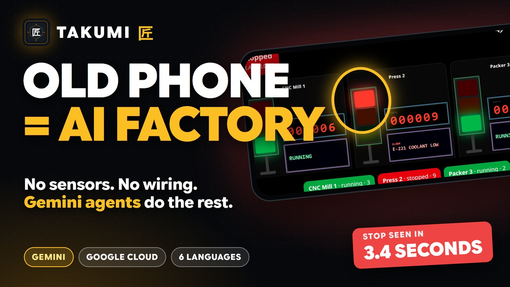

  

## ⚡ Featured build

<table>
<tr>
<td width="56%" valign="middle">

</td>
<td width="44%" valign="middle">

**TAKUMI (匠)** turns an old phone into a factory's eyes and ears. Gemini watches the machines, the manual work and the finished parts; Google ADK agents draft work orders, trace bad units to the step where they went wrong, and answer questions by voice in six languages. A person approves every action.

▶ [Watch the 2:49 demo](https://youtu.be/C8BlBFzSVY4) 
🌐 [Try the live app](https://takumi-cup-2026.web.app) · [tour](https://takumi-cup-2026.web.app/tour) 
📊 [Evaluations, method and costs](https://takumi-cup-2026.web.app/evals) 
📦 [Source and architecture](https://github.com/DivineTechie/takumi)

</td>
</tr>
</table>

## 🛰️ What I work with

## 🧭 How I build

<table>
<tr>
<td width="33%" valign="top">

### 🚀 Ship it live
Real deployments, real traffic, real logs. A prototype is done when someone else can use it.

</td>
<td width="33%" valign="top">

### 📏 Measure, don't promise
Every number carries its source. Evaluations live next to the code, with their caveats.

</td>
<td width="33%" valign="top">

### 🤝 People decide
AI sees, explains and drafts. A person approves anything that changes the real world.

</td>
</tr>
</table>

## 🔭 Right now

- 🏭 Shipping **TAKUMI** for the Google Cloud AI Builder Cup 2026 with team AUREX
- 🧠 Building agentic workflows with **Google ADK**, **Gemini Live** and function calling
- 🌏 Making AI useful in every language on the shop floor

